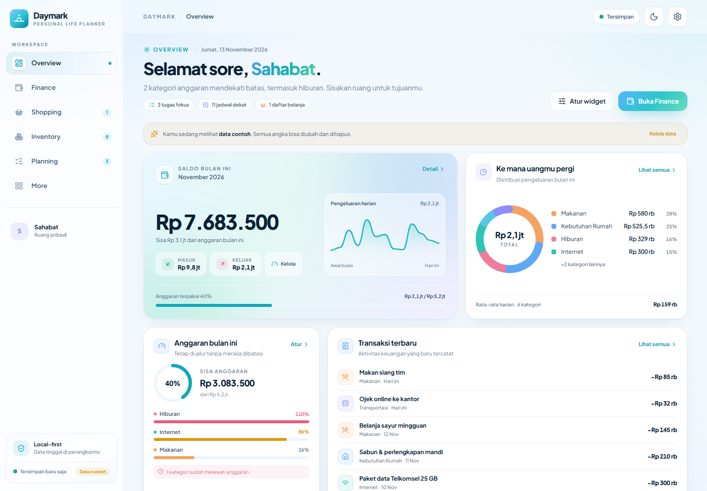
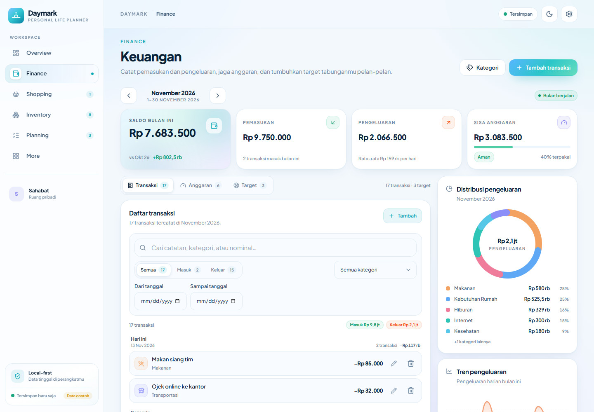
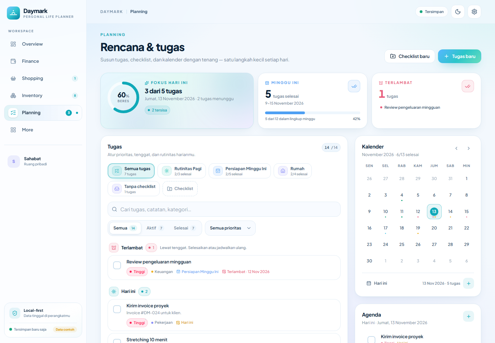
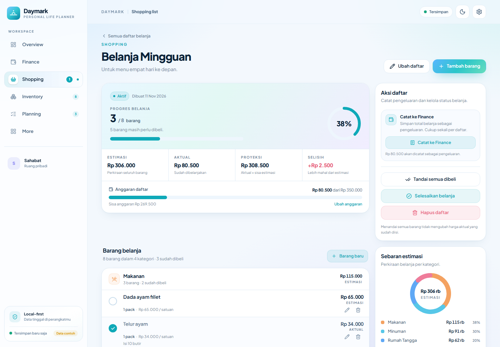
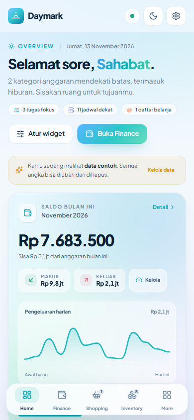
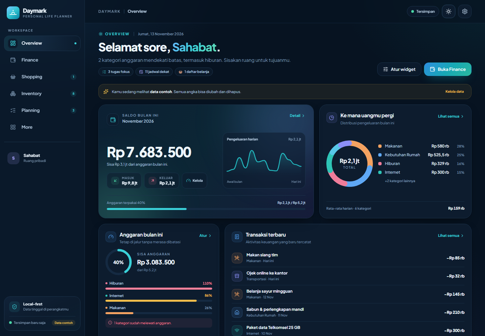

# Daymark

**A calm, local-first personal life planner.**  
Daymark brings money, shopping, food stock, plans, and reflection into one quiet place — no account, no server, no noise.

Built as a mobile-first Progressive Web App with React, TypeScript, IndexedDB, and a hand-tuned design system. It is designed to be used every day and to look like a product, not a template.

---

## Highlights

- **Overview dashboard** with live metrics, configurable widgets, recent transactions, budget warnings, upcoming items, shopping/inventory summaries, goals, tasks, and the latest review.
- **Finance** — income/expense transactions, custom categories, month-scoped budgets, budget vs actual warnings, spending visualisations, and savings goals with contribution history.
- **Shopping lists** — multiple lists, group-by-category items, estimated vs actual pricing, completion progress, and a one-click link to Finance that cannot create duplicates.
- **Inventory + meal planner** — stock levels, minimum stock, expiry dates, storage locations, low-stock/expiry alerts, and a weekly breakfast/lunch/dinner plan with ingredient aggregation and cost estimates.
- **Internet & subscriptions** — devices, data packages, remaining quota, expiry tracking, purchase history, recurring subscriptions, payment reminders, and mark-as-paid that writes a real Finance transaction.
- **Planning** — checklists, tasks with priorities/deadlines/categories, animated completion, progress overview, and a month calendar with day agenda.
- **Periodic reviews** — daily, weekly, or monthly reviews with live period snapshots (spending, prorated budget, savings progress, completed activities), private notes/reflection, rating, and a searchable history.
- **Local-first data** — auto-save to IndexedDB, JSON export/import with validation, last-backup metadata, demo data opt-in, and destructive-action confirmations.
- **Offline PWA** — installable standalone app with a cached app shell, offline navigation, service-worker updates, and an offline-ready notification.
- **Thoughtful interface** — responsive desktop sidebar and mobile bottom navigation, light/dark themes, reduced-motion support, count-up money, animated charts/checklists/modals/toasts, and accessible controls.

## Screens

> Screenshots use the optional demo workspace.

| Overview | Finance |
| --- | --- |
|  |  |

| Planning | Shopping detail |
| --- | --- |
|  |  |

| Mobile | Dark mode |
| --- | --- |
|  |  |

## Tech stack

- React 19 + TypeScript (strict) + Vite
- Tailwind CSS 4 with CSS custom-property design tokens
- Framer Motion for motion, Lucide for icons
- IndexedDB via `idb`; one versioned `AppData` document per workspace
- Zod for import validation
- vite-plugin-pwa + Workbox for the manifest, service worker, precache, and offline shell
- Vitest for calculation and backup-validation tests

## Getting started

Requirements: Node.js 20+.

```bash
npm install
npm run dev          # http://localhost:5173
```

Production build and local PWA preview:

```bash
npm run build
npm run preview      # http://localhost:4173
```

Open the preview URL in Chrome/Edge and use **Install app** from the browser menu. After the first load the app shell is cached and remains usable without a network connection. Data stays in the browser profile used to install it.

### Useful scripts

| Command | Purpose |
| --- | --- |
| `npm run dev` | Vite development server |
| `npm run build` | Typecheck + production build + PWA assets |
| `npm run preview` | Serve the production build |
| `npm run typecheck` | TypeScript project check |
| `npm test` | Vitest unit tests |
| `npm run test:e2e` | Playwright smoke tests (requires Chrome; starts a dev server on port 4173) |
| `npm run lint` | Oxlint |
| `python scripts/generate_icons.py` | Regenerate PWA/favicon PNGs from the Daymark mark |

## Data model & privacy

There is intentionally **no backend and no login** in v1.

- All user data lives in `localStorage` fallback or IndexedDB under the `daymark` database.
- The complete state is a serialisable `AppData` document (`src/types/domain.ts`) with a schema version — ready for an optional future sync layer without redesigning every feature.
- Export produces a single JSON backup envelope (`app: "daymark"`, schema version, export timestamp, full state).
- Import validates structure, amounts, dates, referential integrity, and duplicate IDs before replacing anything. A confirmation step shows the imported record counts.
- The **Data contoh** demo workspace is opt-in and can be removed from **Settings → Data & backup**. A fresh workspace contains starter categories only.

Default currency is **Rupiah (IDR)**; currency can be changed in Settings. Changing currency does not convert existing numeric values.

## Architecture

```
src/
  components/
    ui/          shared primitives (buttons, fields, modal/sheet, toast, progress…)
    charts/      custom donut, trend, sparkline and circular progress
    layout/      app shell, sidebar, top bar, bottom nav, boot screens
    theme/       theme resolution + dark mode sync
  features/
    finance/     finance page + modals, tabs, analytics
    shopping/    list index/detail + items and finance linkage
    inventory/   stock + meal planner
    planning/    tasks, checklists, calendar
    reviews/     periodic review composer, history, detail
    internet/    data packages and subscriptions
    dashboard/   overview page and configurable widget system
  lib/
    store.ts     reactive store, persistence scheduling, all domain actions
    storage.ts   IndexedDB/fallback persistence
    calc.ts      pure calculations and selectors used across screens
    validation.ts backup import schema + integrity checks
    seed.ts/demo.ts, dates.ts, format.ts, constants.ts, motion.ts
  pages/         More, Settings, NotFound
  index.css      design tokens, light/dark palettes, surfaces, motion CSS
```

**Data flow:** UI → `actions` from `src/lib/store.ts` → immutable `AppData` snapshot → auto-save (debounced) → IndexedDB. Selectors/calculations stay pure in `src/lib/calc.ts`, so every page reads the same source of truth.

## Quality notes

- Every CRUD flow uses the shared store and real persisted data; no decorative controls or permanent dummy data.
- Budget calculations are month-scoped; review budgets are prorated across overlapping months for daily/weekly ranges.
- Shopping-to-Finance recording is idempotent and reversible, and never double-counts a list.
- Offline-first behaviour was verified with a production build: service worker registration, offline reload, offline route navigation, offline data writes, and persistence after reconnecting.
- Motion respects `prefers-reduced-motion`; micro-interactions stay within 120–350 ms.
- Unit tests cover transaction/budget math, goals, shopping totals, inventory status, tasks, data packages, subscriptions, meal aggregation, review snapshots, and backup validation.

## Roadmap

- Optional encrypted cloud sync and cross-device backup (data model already versioned for it)
- Recurring transactions and deeper cash-flow projections
- Home-screen quick actions and richer calendar integrations
- Localised currency/date presets beyond the current set

---

Made for the quiet work of keeping a life in order.
